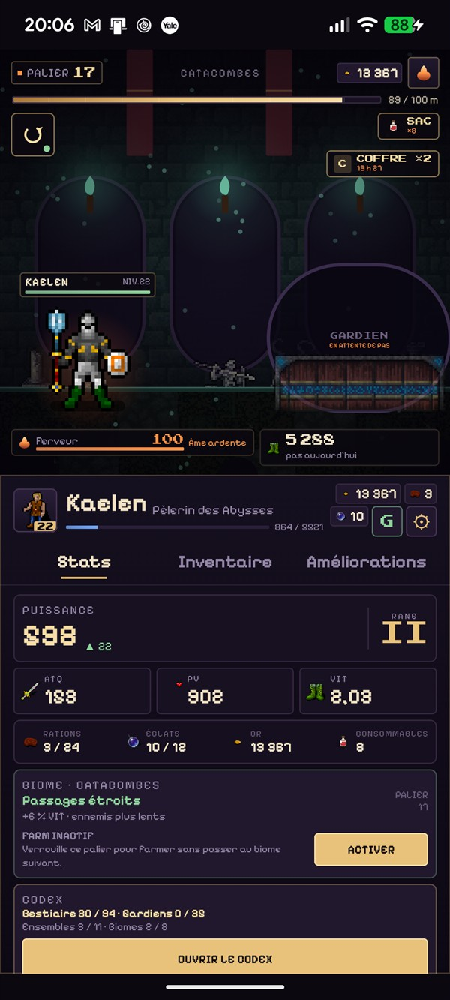
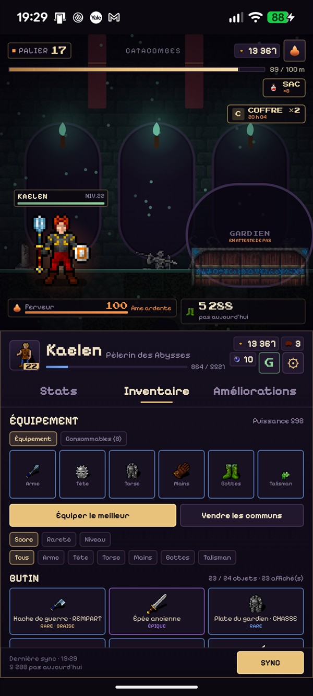
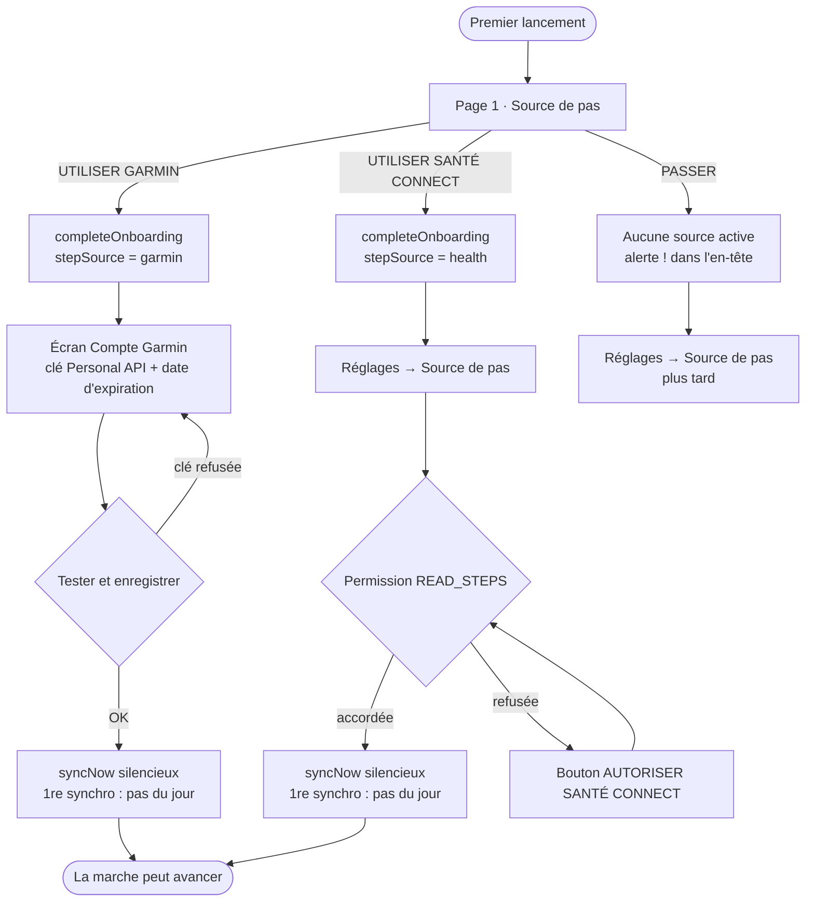
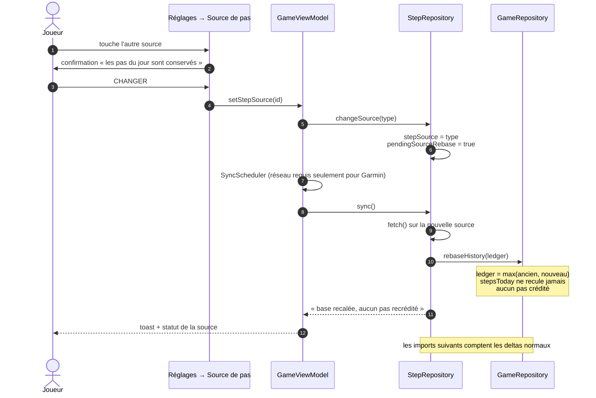

# La Marche des Âmes

**RPG de marche Android en pixel art.** Vos pas (Garmin ou Santé Connect) deviennent la distance parcourue par un pèlerin dans un donjon infini. Le héros marche, combat, ouvre des coffres et affronte les gardiens automatiquement ; vous intervenez sur l’équipement, le camp, les consommables et les choix.

- **Deux sources de pas au choix** — Garmin Personal API ou Santé Connect, une seule active à la fois.
- **Changement de source sans double comptage** — le premier import de la nouvelle source sert de base.
- **2FA Garmin dans le navigateur** — l’application ne voit jamais le mot de passe ni le code.
- **Aucun serveur éditeur** — progression, clé et jeton restent sur le téléphone.
- **Hors ligne** — la progression continue avec les pas déjà récupérés.

**Version :** 0.17.5 · **Android :** 14+ · `com.brunothesatellite.idlesteprpg`

[APK Android](https://github.com/brunothesatellite/idle-step-rpg/releases/latest) ·
[Manuel HTML](manuel/index.html) ·
[Manuel en ligne](https://brunothesatellite.github.io/idle-step-rpg/manuel/) ·
[Démonstration web](https://brunothesatellite.github.io/idle-step-rpg/)

---

## Histoire

*Les âmes ne meurent pas. Elles attendent.*

On raconte qu'aux portes de Vael, la terre s'est ouverte un matin sans trembler. Pas de gouffre, pas de feu : une porte de pierre, basse, couverte de runes, et derrière elle un escalier qui descendait plus loin que la lumière.

Les premiers à y entrer ne sont pas revenus. Pas morts — retenus. Leurs noms sont restés accrochés aux murs, et depuis, chaque salle du donjon respire avec le souffle de quelqu'un qui n'a pas fini de partir.

Kaelen était pèlerin. Il portait une besace, une lame héritée, et une braise dans un pot de fer. On le disait lent. C'est pour ça qu'on lui a confié la marche : les âmes n'ont pas besoin de héros pressés.

Il a compris une chose simple : les donjons ne sont pas des tombeaux, ce sont des nœuds. Chaque palier est un fil serré autour d'une âme. Le gardien qui le scelle n'est pas un bourreau — c'est le dernier gardien d'une douleur, celui qui refuse de la laisser partir. Alors Kaelen marche. Dix pas pour un mètre, cent mètres pour un palier. Chaque pas est un mot dans une prière qu'il ne prononce pas à voix haute.

Aux Cryptes de Vael, la pierre est froide et les cierges brûlent sans cire. Aux Catacombes, l'air sent la mousse et les serments anciens. Dans les Cavernes de cendre, il apprend à respirer court. Dans la Forge noyée, il pose la main sur les enclumes et sent encore la chaleur de ceux qui forgeaient pour les vivants. Aux Cimes du Serment, le vent lui vole ses mots. Dans le Bois des Âmes, les arbres ont des feuilles d'or et des racines qui se souviennent. Dans l'Abîme organique, la pierre saigne et il ne s'arrête pas. Au Trône des Âmes, il n'y a plus de couloir : seulement une porte, un gardien, et derrière, la Première Âme, celle qui a refusé de partir la première.

La braise ne s'éteint jamais. Tant qu'il marche, elle veille ; quand il s'arrête, il la pose au centre du camp, et les âmes qui passent s'y réchauffent sans oser s'approcher.

Kaelen ne cherche pas la fin. Il sait qu'il n'y en a pas. Il cherche la prochaine âme qui acceptera de respirer.

*« La défaite n'est qu'un détour. Vingt mètres en arrière, l'or coule encore. »*

---

## Aperçu

<div>
  
  
  
</div>

<div align="center">
  <video src="https://github.com/user-attachments/assets/7f6cdf51-0665-4552-be4c-94a4e284f32d" controls></video>
</div>

---

## Le jeu en bref

- **10 pas = 1 mètre**, **100 m = un palier**. Un gardien attend à 100 m.
- Le héros consomme automatiquement la réserve de pas : marche, rencontres tous les 10 m, combats, coffres, gardiens.
- Les combats sont automatiques : ATQ, PV, VIT, critique, régénération, ferveur, équipement, buffs.
- Le **camp** met la marche en pause, réinitialise un combat, soigne, donne accès au journal, à l’inventaire et aux potions.
- Les **coffres** restent 24 h, deux maximum en attente. Ils ne bloquent jamais la route ; « Consacrer mes pas » fige la marche pour forcer la serrure, et la fiche peut être masquée en laissant le forçage tourner.
- **Lisibilité** : quatre tailles de texte (**Normal, Grand, Très grand, Maximal**), animations réduites, vibrations réglables.
- Les **serments journaliers**, la **ferveur**, les **consommables**, la **forge**, les **ensembles** et les **rencontres spéciales** ajoutent de la profondeur.
- Le **reset quotidien** se fait à **00:00 local**, en accord avec le `calendarDate` Garmin.
- Le **résumé d'absence** fait avancer le jeu pendant la fermeture : **30 % des pas du jour** par défaut (réglable de 0 à 30 %, ou en nombre de pas, dans **Réglages avancés**) et **4 min simulées** au maximum, avec arrêt sur événement (rencontre spéciale, nouveau coffre, passage au camp) ; devant le gardien, la simulation ne s'arrête que s'il reste moins d'un palier de budget, sinon le combat est joué et le gardien peut être vaincu. Un écran **« Bon retour »** résume l'absence.

### Biomes et contenu

Le donjon traverse **8 biomes** de 10 paliers, chacun avec ses murs, sols, statues, props, portes et météo :

| Paliers | Biome | Ambiance |
|---|---|---|
| 1–10 | Cryptes de Vael | pierre violette, poussière, portes fermées |
| 11–20 | Catacombes | pierre verte, spores, portes runiques |
| 21–30 | Cavernes de cendre | roche volcanique, braises, fontaines de sang |
| 31–40 | Forge noyée | métal, étincelles, bassins bleus |
| 41–50 | Cimes du Serment | glace, neige, cristaux |
| 51–60 | Bois des Âmes | herbe, arbres d'or, feuilles |
| 61–70 | Abîme organique | slime, spores, acidité |
| 71+ | Trône des Âmes | enfer rouge, cendres, portes scellées |

Chaque biome a ses **pools de monstres** (faciles, intermédiaires, difficiles), ses **boss**, ses **tables de butin**, ses **ensembles** et sa **règle active** (critique, VIT, régénération, défense, etc.). Les gardiens possèdent une **capacité propre** (drain, régénération, frappe lourde, blindage, souffle, racines, acide, pression) affichée pendant le combat. Le héros affiche désormais un **paper doll par famille d’équipement** : casque, armure, jambes, bottes et arme changent selon l’objet équipé.

Le **Codex** (`Stats → Codex`) suit le bestiaire, les ensembles et les biomes. Le **mode Farm** se trouve dans la carte BIOME : **inactif par défaut**, il verrouille le palier actuel et affiche un badge FARM ; les jalons sont désactivés pendant le farm. La synchronisation Garmin utilise un **petit bouton carré en haut à gauche de la scène**, aligné avec le SAC.

### Boucle quotidienne

1. Vous marchez : montre Garmin, téléphone ou application reliée à Santé Connect.
2. La source choisie expose les pas (Garmin Connect via la Personal API, ou Santé Connect alimenté par Google Fit, Samsung Health ou une montre).
3. **Première connexion** : seuls les pas de la journée sont importés. Ensuite, l’application peut rattraper les **7 derniers jours** — jamais avant la date de première connexion — avec un plafond de **100 000 pas** par synchronisation (un marathon fait environ 45 000 pas).
4. Les pas alimentent la réserve de marche et la ferveur.
5. Le héros avance, combat, ramasse, et vous gérez le camp et l’équipement.

---

## Manuel utilisateur

Le manuel complet contient les mécaniques, les tableaux, les écrans et la FAQ.

- **Dans l’application** : `Réglages → Aide → Ouvrir le manuel du jeu`.
- **HTML dans le dépôt** : [`manuel/index.html`](manuel/index.html)
- **En ligne** : <https://brunothesatellite.github.io/idle-step-rpg/manuel/>
- **Captures** : [`manuel/images/`](manuel/images/)

Il est embarqué dans l’APK (`android/app/src/main/assets/manuel/`) et s’ouvre hors ligne dans une activité WebView native.

---

## Installation Android

### Depuis GitHub Releases

1. Téléchargez le dernier APK : [releases/latest](https://github.com/brunothesatellite/idle-step-rpg/releases/latest).
2. Sur le téléphone, autorisez l’installation d’applications inconnues pour le navigateur ou le gestionnaire de fichiers.
3. Ouvrez l’APK et installez-le.

### Avec ADB

```bash
adb install -r La-Marche-des-Ames-v0.17.5.apk
```

Les mises à jour installées avec la même signature conservent les données. L’application est sideloadée, pas publiée sur le Play Store.

---

## Mises à jour de l’application

L’application vérifie les **releases GitHub** et peut installer l’APK signé sans Play Store.

- **Vérification automatique** : active par défaut, au plus une fois toutes les 24 h au lancement.
- **Vérification manuelle** : `Réglages → Mises à jour → Vérifier maintenant`.
- **Téléchargement** : l’APK de la release est téléchargé dans le cache, puis vérifié par **SHA-256** quand l’empreinte est publiée dans les notes.
- **Installation** : toujours confirmée par vous. Android peut demander d’autoriser « Installer des applications inconnues » pour La Marche des Âmes.
- **Après installation** : l’application propose d’ouvrir la **page GitHub de la release** pour lire les changements.

La progression, les réglages et la clé Garmin sont conservés tant que l’APK est signé avec la même clé.

En cas d’avertissement ou de blocage **Play Protect**, installez l’APK manuellement depuis la page GitHub de la release : Android protège les applications inconnues de Google, mais l’APK est signé et son empreinte SHA-256 est publiée.

---

## Choisir la source de pas

À l’installation, l’onboarding propose **Garmin** ou **Santé Connect**. Le choix se change ensuite dans **Réglages → Source de pas**.

- **Garmin** : clé personnelle, jeton de 24 h, synchronisation réseau toutes les 60 min.
- **Santé Connect** : lecture locale des pas enregistrés par Google Fit, Samsung Health ou une montre. Permission `android.permission.health.READ_STEPS`. Sans application fournisseur, le hub renvoie zéro pas. La lecture se fait à l’ouverture et manuellement : Android refuse l’accès en arrière-plan sans la permission `READ_HEALTH_DATA_IN_BACKGROUND`, donc le worker périodique ne la tente pas.
- **Première connexion** : seuls les pas du jour sont crédités. Les synchronisations suivantes peuvent rattraper jusqu’à **7 jours**, mais jamais avant la date de première connexion : on ne démarre pas avec une réserve de pas héritée de la semaine précédente.
- **Pas de double comptage** : une seule source est lue à la fois, et les enregistrements Santé Connect sont agrégés par origine (téléphone, montre) en gardant le total le plus élevé par jour.
- **Diagnostic** : **Réglages → Diagnostic** affiche la source active et les 7 derniers jours avec leur état (crédité, aujourd’hui, avant connexion, aucun pas), les garde-fous et un bouton de synchronisation. Le journal de synchronisation est horodaté au jour et à l’heure.

### Flux de connexion à l’onboarding



### Flux de changement de source en jeu



Règles appliquées par ce flux :

| Situation | Résultat |
|---|---|
| Nouvelle source plus généreuse (ex. 9 000 au lieu de 5 000) | Le total du jour passe à 9 000 **sans créditer** 4 000 pas ; les pas suivants comptent. |
| Nouvelle source moins généreuse (ex. 2 000 au lieu de 6 000) | Le total reste à 6 000 ; les pas ne reculent jamais. |
| Changement répété dans la même journée | Chaque changement repose une base ; aucun double comptage. |
| Partie neuve sans pas | Aucun rebase : le premier import est crédité normalement. |
| Garmin → Santé Connect → Garmin | La clé Garmin reste stockée, la source est relue à chaque fois. |

Fenêtre d’import des pas :

| Moment | Jours lus | Jours crédités |
|---|---|---|
| Toute première synchronisation | Aujourd’hui seulement | Aujourd’hui seulement |
| Synchronisations suivantes | 7 derniers jours | Uniquement les jours compris entre la **date de première connexion** et aujourd’hui |
| Oubli de synchronisation de 3 jours | 7 derniers jours | Les 3 jours manquants (dans la limite du plafond de 100 000 pas) |

## Connecter Garmin (clé Personal API)

1. Ouvrez l’application → **Réglages → Source de pas → Garmin → Gérer la clé**.
2. Appuyez sur **Ouvrir Garmin Connect**. La connexion et la **2FA** se font dans le navigateur.
3. Dans Garmin Connect, créez une **Personal API Key** et copiez-la.
4. Revenez dans l’application, collez la clé.
5. Renseignez la **date d’expiration** : Garmin ne l’expose pas via l’API, c’est vous qui la saisissez pour les rappels.
6. Appuyez sur **Tester et enregistrer**, puis **Synchroniser**.

La clé est échangée contre un **jeton OAuth2 de 24 h**. Il n’y a pas de refresh token : l’application redemande un jeton avec la clé. Clé et jeton sont chiffrés dans **Android Keystore**.

### En cas de problème

| Code | Signification | Action |
|---|---|---|
| 401 | Clé invalide, expirée ou révoquée | Créer une nouvelle clé et la coller. |
| 403 | Accès refusé | Vérifier la clé Garmin. |
| 429 | Trop de requêtes | Attendre le délai indiqué. |
| 5xx | Garmin indisponible | Réessayer plus tard. |

Si Garmin renvoie toujours le même total, la montre n’a pas encore poussé ses pas. Ouvrez Garmin Connect, laissez la montre synchroniser, puis resynchronisez.

> **Sécurité :** ne committez jamais une clé Garmin. Si elle a été exposée, révoquez-la dans Garmin Connect et créez-en une nouvelle.

---

## Compiler

### Prérequis

- **JDK 21** (Temurin recommandé).
- **Android SDK 36** et build-tools 36.0.0.
- Le wrapper Gradle est fourni (`gradlew`, `gradlew.bat`).

### Debug

```bash
cd android
./gradlew :app:assembleGithubDebug
```

Le build debug utilise le package `com.brunothesatellite.idlesteprpg.debug` et peut cohabiter avec la version release. Sa copie porte un **nom** (« Marche des Âmes · test ») et une **icône distincte** (fond turquoise), avec ses propres données, sa propre clé Garmin et sa propre autorisation Santé Connect. Le vérificateur de mises à jour y est **désactivé** : il ne peut pas proposer l'APK de production (qui installerait l'autre application).

### Release signé

Le build release lit `../.keystore/keystore.properties` (local, ignoré par Git) :

```properties
storeFile=idle-step-rpg-release.jks
storePassword=...
keyAlias=idle-step-rpg
keyPassword=...
```

Deux variantes partagent le même paquet et la même clé :

```bash
cd android
# APK GitHub (mise à jour intégrée)
./gradlew :app:assembleGithubRelease

# AAB Play (sans installateur d'APK ni vérification GitHub)
./gradlew :app:bundlePlayRelease
```

APK : `android/app/build/outputs/apk/github/release/app-github-release.apk`  
AAB : `android/app/build/outputs/bundle/playRelease/app-play-release.aab`

Sans keystore, seul le build debug est possible. Le keystore et les mots de passe ne sont **jamais** dans le dépôt. La distribution, la mise à jour croisée et la clé Play sont détaillées dans [`playstore/05-distribution/`](playstore/05-distribution/).

### Tests et lint

```bash
# Tests moteur
./gradlew :app:testDebugUnitTest

# Tests UI Compose (sur appareil/émulateur, package .debug)
./gradlew :app:connectedDebugAndroidTest

# Android lint
./gradlew :app:lintDebug
```

La CI GitHub exécute les tests, le lint et l’APK debug. Un workflow de release signée existe et s’active si les secrets de signature sont configurés.

---

## Architecture

```
Garmin Personal API                  Santé Connect (local)
   │ HTTPS, jeton 24 h                  │ READ_STEPS, agrégation par origine
   ▼                                    ▼
GarminClient ──► GarminRepository   HealthConnectSource
          └──────────────┬──────────────────┘
                         ▼
                   StepRepository  (source active, rebase, journal)
                         ▼
                   GameRepository  (sauvegarde atomique)
                         ▼
                     GameEngine   (simulation, combats, loot)
                         │ StateFlow<GameState>
                         ▼
                    GameViewModel
                         ▼
              Jetpack Compose / MainActivity
```

En parallèle :

```
WorkManager ──► GarminSyncWorker (60 min, source active)
            └► MaintenanceWorker (15 min : coffres, clé)
```

### Stack

- **Kotlin**, **Jetpack Compose**, Material 3.
- `minSdk 34`, `targetSdk 35`, `compileSdk 36`, un seul module `:app`.
- **OkHttp** pour Garmin.
- **kotlinx.serialization** pour la sauvegarde JSON.
- **WorkManager** pour la synchronisation et la maintenance.
- **Android Keystore** pour la clé et le jeton.
- **SoundPool** pour les sons 8 bits.
- **Media3 ExoPlayer** pour les musiques d'ambiance en boucle.
- **WebView native** pour le manuel hors ligne.
- **FileProvider** pour installer les APK téléchargés depuis GitHub Releases.

### Paquets principaux

| Chemin | Rôle |
|---|---|
| `App.kt` / `AppContainer` | Initialisation, dépendances, notifications, sons, WorkManager. |
| `GameViewModel.kt` | État UI, tick 100 ms, synchronisation, réglages, overlays. |
| `MainActivity.kt` | Composition racine, navigation entre scène et tableau de bord. |
| `HealthRationaleActivity.kt` | Écran de justification exigé par Santé Connect (Android 14+). |
| `ManualActivity.kt` | Manuel HTML hors ligne. |
| `update/UpdateChecker.kt` | Releases GitHub, comparaison de versions, SHA-256, téléchargement de l’APK. |
| `engine/Model.kt` | État sérialisable, objets, consommables, buffs, ensembles, stats. |
| `engine/GameEngine.kt` | Pas, combat, coffres, camp, forge, rencontres, simulation hors ligne. |
| `data/GameRepository.kt` | Persistance JSON, copie de secours, import/export, tick, mutations. |
| `data/SettingsStore.kt` | Préférences locales (texte, notifications, sons, etc.). |
| `garmin/GarminClient.kt` | Endpoints Garmin Personal API, jeton, pas, erreurs 401/429. |
| `garmin/GarminRepository.kt` | Synchronisation 7 jours, ledger, expiration de clé, journal de sync. |
| `garmin/SecretStore.kt` | Chiffrement Keystore. |
| `steps/StepRepository.kt` | Source de pas active, changement de source, rebase, journal. |
| `steps/HealthConnectSource.kt` | Permission READ_STEPS, agrégation par origine, 7 jours. |
| `notify/GameNotifications.kt` | Canaux, catégories, heures calmes, deep links. |
| `sync/` | Workers WorkManager. |
| `widget/` | Widget d’écran d’accueil. |
| `ui/` | Compose : scène, dashboard, overlays, réglages, onboarding, manuel. |
| `assets/` | Sprites, sons, manuel et images. |

### Données et persistance

La sauvegarde est un fichier **JSON versionné** (`SAVE_VERSION = 4`) :

- `game_state.json` : état du jeu.
- `game_state.bak.json` : copie de secours (rotation).
- écriture atomique via un fichier temporaire ;
- validation à l’import ;
- export/import avec aperçu ;
- **aucune clé Garmin dans la sauvegarde**.

Deux champs pilotent l’import des pas : `stepLedger` (total retenu par jour, jamais recrédité) et `historyStart` (date de la première connexion, borne basse du rattrapage).

Les évolutions de schéma utilisent des valeurs par défaut et `GameEngine.migrate()`. Une migration Room est dans le backlog, pas dans cette version.

### Garmin

- `POST /personalapitoken-service/personal-api/personal-api-key/token` avec `Authorization: ApiKey <clé>`.
- `GET /usersummary-service/stats/steps/daily/{start}/{end}` avec `Authorization: Bearer <jeton>`.
- Jeton JWT, expiration lue dans le payload, 24 h.
- 7 jours d'historique, ledger par jour idempotent, jamais avant la date de première connexion.
- Plafond **100 000 pas** par synchronisation, **60 000 pas/jour**, contrôle **250 pas/min**.
- Retry sur 401 (nouveau jeton) et backoff sur 429 (`Retry-After`).

### Tests

- Tests moteur : import multi-jours, plafonds, serments, reset, coffres, ferveur, forge, consommables, sets, camp, simulation, inventaire plein, marathon.
- Tests Garmin : MockWebServer (401, 429, 204, JSON invalide, parsing du jeton).
- Tests UI Compose : coffre, objet non identifié, onboarding, résultat de pari, consommables.

---

## Structure du dépôt

```
idle-step-rpg/
├── android/                 # application Android (Kotlin/Compose)
│   ├── app/src/main/
│   │   ├── java/...         # code
│   │   ├── assets/          # sprites, sons, manuel
│   │   └── res/             # thème, icône, widget
│   ├── app/src/test/        # tests unitaires
│   └── app/src/androidTest/ # tests UI
├── manuel/                  # manuel HTML et captures
│   ├── index.html
│   └── images/
├── docs/
│   ├── specifications-fonctionnelles.md
│   ├── architecture-android-garmin.md
│   ├── consommables.md
│   ├── privacy.md
│   ├── play-store.md
│   └── reste-a-faire.md
├── assets/                  # assets de la démo web et du jeu
├── index.html               # démo web
├── styles.css
├── game.js
├── LICENSES.md
└── .github/workflows/       # CI Android
```

---

## Confidentialité

- Aucun compte propriétaire, aucun backend, aucune publicité, aucun traceur.
- La clé Garmin et le jeton sont chiffrés localement (Android Keystore) et ne partent que vers Garmin.
- **Santé Connect** : les pas sont lus localement avec la permission `READ_STEPS`, jamais envoyés à l'éditeur.
- **Garmin** : la clé personnelle sert uniquement à interroger la Garmin Personal API.
- La politique complète est publiée sur [`/privacy/`](https://brunothesatellite.github.io/idle-step-rpg/privacy/) et dans [`docs/privacy.md`](docs/privacy.md).

---

## Démonstration web

La maquette d’origine reste disponible :

- [`index.html`](index.html) — démonstration jouable ;
- [`styles.css`](styles.css) ;
- [`game.js`](game.js) ;
- en ligne : <https://brunothesatellite.github.io/idle-step-rpg/>.

Elle simule les pas (aucune montre réelle), le choix de la source de pas (Garmin ou Santé Connect) et la fenêtre d'import : première connexion = pas du jour seulement, puis rattrapage borné à 7 jours, jamais avant la date de première connexion. Le bouton **FENÊTRE ›** ouvre le détail (jours crédités, en attente, hors fenêtre, plafond de 100 000 pas) et permet de simuler un oubli de synchronisation. Elle sert de référence de game design. Les spécifications complètes sont dans [`docs/specifications-fonctionnelles.md`](docs/specifications-fonctionnelles.md).

---

## Limites et backlog

- Interface en **français** uniquement.
- **Migration Room** non faite : sauvegarde JSON versionnée avec copie de secours.
- **Publication Play Store** : livrée en 0.17.3 (`versionCode 37`).
- **Mise à jour Gradle** : wrapper 8.11.1 en fin de support ; monter Gradle puis revérifier AGP, Kotlin et un build complet.
- **R8 / minification** : activer R8 + `shrinkResources`, tester kotlinx.serialization, puis uploader `mapping.txt` (supprime l'avertissement Play).
- **Symboles natifs Play** : `libandroidx.graphics.path.so` est fourni strippé par AndroidX ; vérifier une source de symboles ou documenter l'avertissement.
- Équilibrage long terme, farm automatique à 0 pas et réduction automatique des animations sur batterie faible : backlog.
- L'historique est limité à 7 jours, jamais avant la date de première connexion, et à 100 000 pas par synchronisation.
- La synchronisation Garmin dépend de Garmin Connect : la montre doit avoir poussé ses pas.

Voir [`docs/reste-a-faire.md`](docs/reste-a-faire.md).

---

## Licences et crédits

- **Code, textes et direction artistique originale** : MIT — © 2026 brunothesatellite.
- **Pixel art** : Dungeon Crawl Stone Soup contributors, CC0 1.0.
- **Sons 8 bits** : générés pour ce projet, CC0 1.0 (`assets/audio/LICENSE.txt`).
- **Musiques d'ambiance** : 16 pistes originales CC0 (`assets/music/`), deux variantes de 3 minutes par biome, boucle et démarrage aléatoire.
- **Polices** : Pixelify Sans et Press Start 2P, SIL Open Font License 1.1.

Détails : [`LICENSES.md`](LICENSES.md), [`assets/CREDITS.md`](assets/CREDITS.md).


