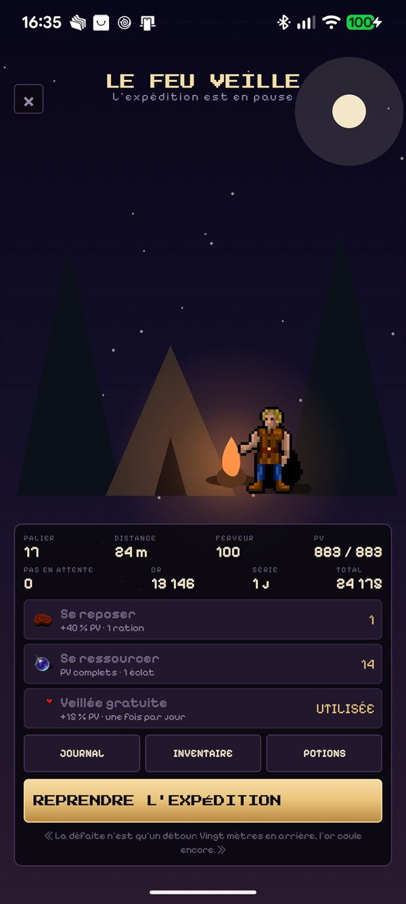
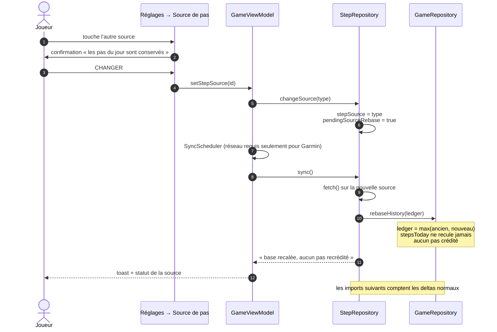
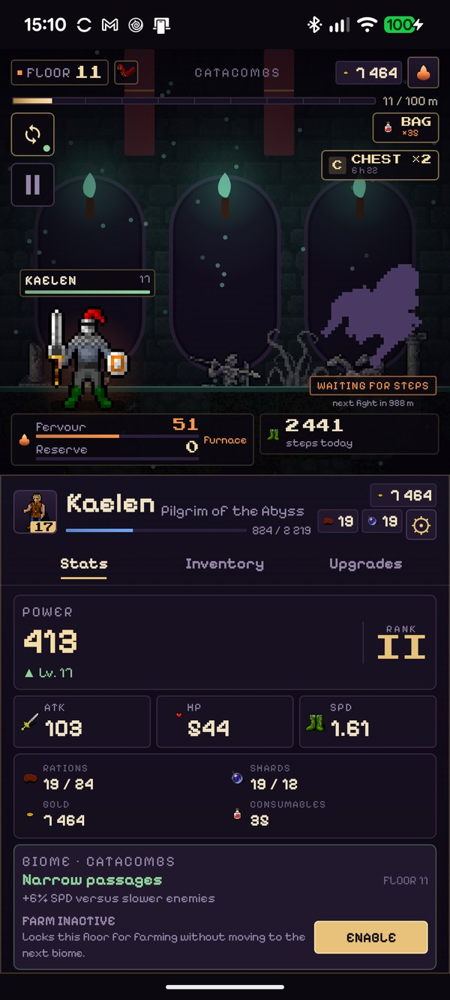
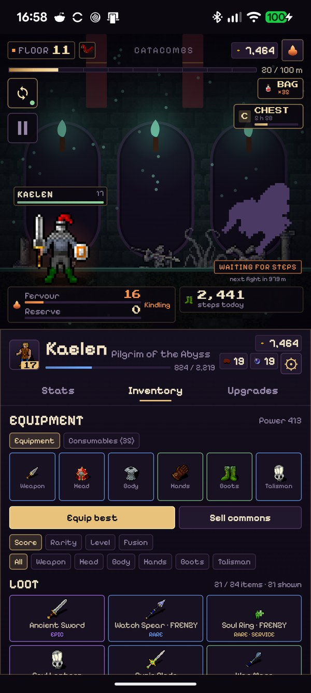
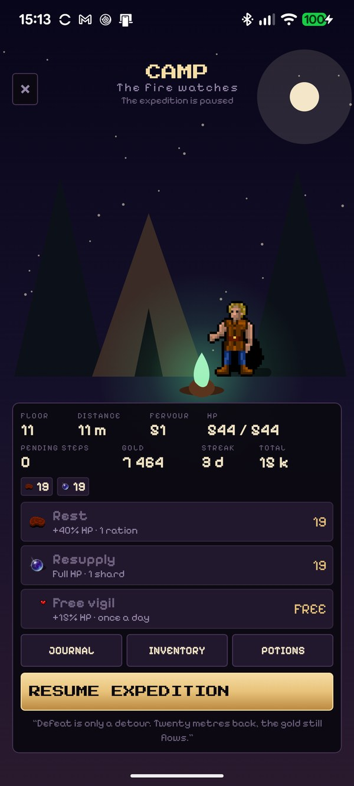
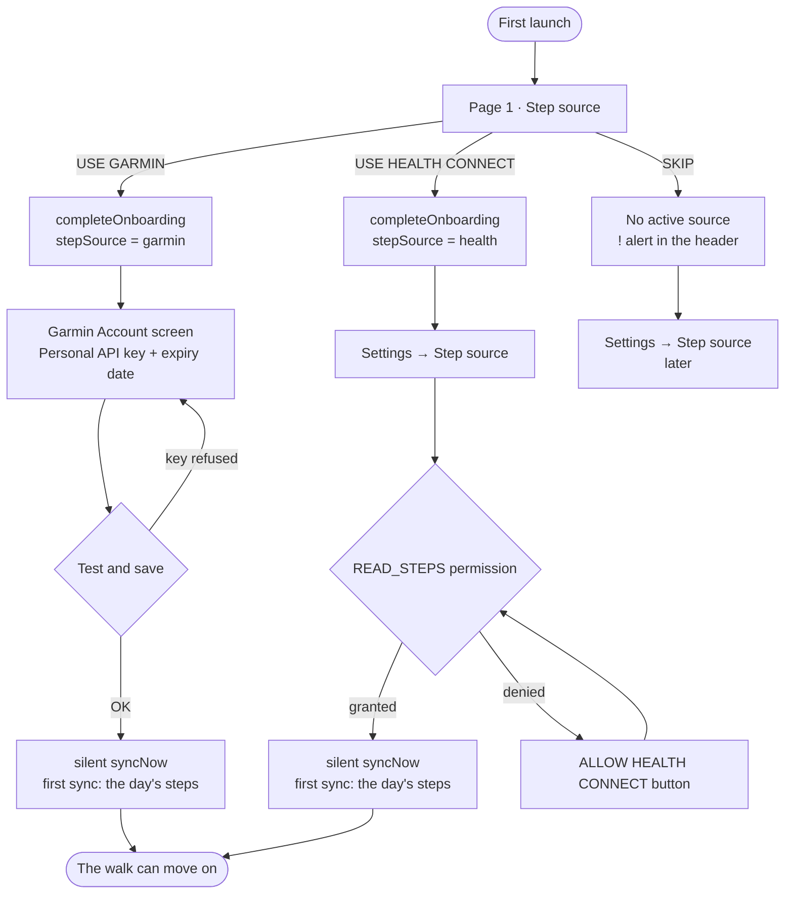
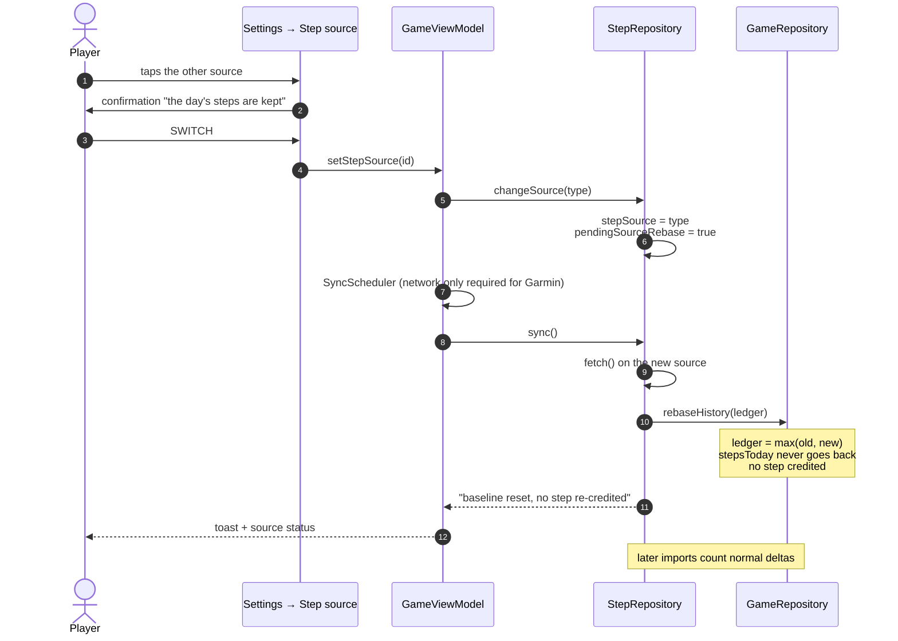

# La Marche des Âmes

[Français](#la-marche-des-âmes) · [English](#the-march-of-souls)

**RPG de marche Android en pixel art.** Vos pas (Garmin ou Santé Connect) deviennent la distance parcourue par un pèlerin dans un donjon infini. Le héros marche, combat, ouvre des coffres et affronte les gardiens automatiquement ; vous intervenez sur l’équipement, le camp, les consommables et les choix.

- **Deux sources de pas au choix** — Garmin Personal API ou Santé Connect, une seule active à la fois.
- **Changement de source sans double comptage** — le premier import de la nouvelle source sert de base.
- **2FA Garmin dans le navigateur** — l’application ne voit jamais le mot de passe ni le code.
- **Aucun serveur éditeur** — progression, clé et jeton restent sur le téléphone.
- **Hors ligne** — la progression continue avec les pas déjà récupérés.
- **Français et anglais** — interface, journal, Codex, manuel et captures dans les deux langues.

**Version :** 0.19.1 · **Android :** 14+ · `com.brunothesatellite.idlesteprpg`

[APK Android](https://github.com/brunothesatellite/idle-step-rpg/releases/latest) ·
[Manuel en ligne](https://brunothesatellite.github.io/idle-step-rpg/manuel/) ·
[Online manual](https://brunothesatellite.github.io/idle-step-rpg/manuel/en/) ·
[Démonstration web (en français uniquement)](https://brunothesatellite.github.io/idle-step-rpg/)

---

## Histoire

*Les âmes ne meurent pas. Elles attendent.*

On raconte qu'aux portes de Vael, la terre s'est ouverte un matin sans trembler. Pas de gouffre, pas de feu : une porte de pierre, basse, couverte de runes, et derrière elle un escalier qui descendait plus loin que la lumière.

Les premiers à y entrer ne sont pas revenus. Pas morts — retenus. Leurs noms sont restés accrochés aux murs, et depuis, chaque salle du donjon respire avec le souffle de quelqu'un qui n'a pas fini de partir.

Kaelen était pèlerin. Il portait une besace, une lame héritée, et une braise dans un pot de fer. On le disait lent. C'est pour ça qu'on lui a confié la marche : les âmes n'ont pas besoin de héros pressés.

Il a compris une chose simple : les donjons ne sont pas des tombeaux, ce sont des nœuds. Chaque palier est un fil serré autour d'une âme. Le gardien qui le scelle n'est pas un bourreau — c'est le dernier gardien d'une douleur, celui qui refuse de la laisser partir. Alors Kaelen marche. Dix pas pour un mètre, cent mètres pour un palier. Chaque pas est un mot dans une prière qu'il ne prononce pas à voix haute.

Aux Cryptes de Vael, la pierre est froide et les cierges brûlent sans cire. Aux Catacombes, l'air sent la mousse et les serments anciens. Dans les Cavernes de cendre, il apprend à respirer court. Dans la Forge noyée, il pose la main sur les enclumes et sent encore la chaleur de ceux qui forgeaient pour les vivants. Aux Cimes du Serment, le vent lui vole ses mots. Dans le Bois des Âmes, les arbres ont des feuilles d'or et des racines qui se souviennent. Dans l'Abîme organique, la pierre saigne et il ne s'arrête pas. Au Trône des Âmes, il n'y a plus de couloir : seulement une porte, un gardien, et derrière, la Première Âme, celle qui a refusé de partir la première.

La braise ne s'éteint jamais. Tant qu'il marche, elle veille ; quand il s'arrête, il la pose au centre du camp, et les âmes qui passent s'y réchauffent sans oser s'approcher.

Kaelen ne cherche pas la fin. Il sait qu'il n'y en a pas. Il cherche la prochaine âme qui acceptera de respirer.

*« La défaite n'est qu'un détour. Vingt mètres en arrière, l'or coule encore. »*

---

## Aperçu

<div>
  
  
  
</div>

<div align="center">
  <video src="https://github.com/user-attachments/assets/7f6cdf51-0665-4552-be4c-94a4e284f32d" controls></video>
</div>

---

## Le jeu en bref

- **10 pas = 1 mètre**, **100 m = un palier**. Un gardien attend à 100 m.
- Le héros consomme automatiquement la réserve de pas : marche, rencontres tous les 10 m, combats, coffres, gardiens.
- Les combats sont automatiques : ATQ, PV, VIT, critique, régénération, ferveur, équipement, buffs.
- Le **camp** met la marche en pause, réinitialise un combat, soigne, donne accès au journal, à l’inventaire et aux potions.
- Les **coffres** restent 24 h, deux maximum en attente. Ils ne bloquent jamais la route ; « Consacrer mes pas » fige la marche pour forcer la serrure, et la fiche peut être masquée en laissant le forçage tourner.
- **Lisibilité** : quatre tailles de texte (**Normal, Grand, Très grand, Maximal**), animations réduites, vibrations réglables.
- Les **serments journaliers**, la **ferveur**, les **consommables**, la **forge**, les **ensembles** et les **rencontres spéciales** ajoutent de la profondeur.
- Le **reset quotidien** se fait à **00:00 local**, en accord avec le `calendarDate` Garmin.
- Le **résumé d'absence** fait avancer le jeu pendant la fermeture : **30 % des pas du jour** par défaut (réglable de 0 à 30 %, ou en nombre de pas, dans **Réglages avancés**) et **4 min simulées** au maximum, avec arrêt sur événement (rencontre spéciale, nouveau coffre, passage au camp) ; devant le gardien, la simulation ne s'arrête que s'il reste moins d'un palier de budget, sinon le combat est joué et le gardien peut être vaincu. Un écran **« Bon retour »** résume l'absence.

### Biomes et contenu

Le donjon traverse **8 biomes** de 10 paliers, chacun avec ses murs, sols, statues, props, portes et météo :

| Paliers | Biome | Ambiance |
|---|---|---|
| 1–10 | Cryptes de Vael | pierre violette, poussière, portes fermées |
| 11–20 | Catacombes | pierre verte, spores, portes runiques |
| 21–30 | Cavernes de cendre | roche volcanique, braises, fontaines de sang |
| 31–40 | Forge noyée | métal, étincelles, bassins bleus |
| 41–50 | Cimes du Serment | glace, neige, cristaux |
| 51–60 | Bois des Âmes | herbe, arbres d'or, feuilles |
| 61–70 | Abîme organique | slime, spores, acidité |
| 71+ | Trône des Âmes | enfer rouge, cendres, portes scellées |

Chaque biome a ses **pools de monstres** (faciles, intermédiaires, difficiles), ses **boss**, ses **tables de butin**, ses **ensembles** et sa **règle active** (critique, VIT, régénération, défense, etc.). Les gardiens possèdent une **capacité propre** (drain, régénération, frappe lourde, blindage, souffle, racines, acide, pression) affichée pendant le combat. Le héros affiche désormais un **paper doll par famille d’équipement** : casque, armure, jambes, bottes et arme changent selon l’objet équipé.

Le **Codex** (`Stats → Codex`) suit le bestiaire, les ensembles et les biomes. Le **mode Farm** se trouve dans la carte BIOME : **inactif par défaut**, il verrouille le palier actuel et affiche un badge FARM ; les jalons sont désactivés pendant le farm. La synchronisation Garmin utilise un **petit bouton carré en haut à gauche de la scène**, aligné avec le SAC.

### Boucle quotidienne

1. Vous marchez : montre Garmin, téléphone ou application reliée à Santé Connect.
2. La source choisie expose les pas (Garmin Connect via la Personal API, ou Santé Connect alimenté par Google Fit, Samsung Health ou une montre).
3. **Première connexion** : seuls les pas de la journée sont importés. Ensuite, l’application peut rattraper les **7 derniers jours** — jamais avant la date de première connexion — avec un plafond de **100 000 pas** par synchronisation (un marathon fait environ 45 000 pas).
4. Les pas alimentent la réserve de marche et la ferveur.
5. Le héros avance, combat, ramasse, et vous gérez le camp et l’équipement.

---

## Manuel utilisateur

Le manuel complet contient les mécaniques, les tableaux, les écrans et la FAQ. Il existe en **français** et en **anglais**, avec un sélecteur de langue.

- **Dans l’application** : `Réglages → Aide → Ouvrir le manuel du jeu` (le manuel suit la langue de l’app).
- **HTML dans le dépôt** : [`manuel/index.html`](manuel/index.html) (FR), [`manuel/en/index.html`](manuel/en/index.html) (EN)
- **En ligne** : <https://brunothesatellite.github.io/idle-step-rpg/manuel/> (FR), <https://brunothesatellite.github.io/idle-step-rpg/manuel/en/> (EN)
- **Captures** : [`manuel/images/`](manuel/images/) (FR), [`manuel/en/images/`](manuel/en/images/) (EN)

Il est embarqué dans l’APK (`android/app/src/main/assets/manuel/` et `manuel/en/`) et s’ouvre hors ligne dans une activité WebView native.
Le HTML publié et les assets sont générés au build depuis `manuel/index.template.html` et `manuel/index.en.template.html` ; la tâche Gradle `generateManual` y injecte les compteurs réels du Codex et la version de l’application.

---

## Installation Android

### Depuis GitHub Releases

1. Téléchargez le dernier APK : [releases/latest](https://github.com/brunothesatellite/idle-step-rpg/releases/latest).
2. Sur le téléphone, autorisez l’installation d’applications inconnues pour le navigateur ou le gestionnaire de fichiers.
3. Ouvrez l’APK et installez-le.

### Avec ADB

```bash
adb install -r La-Marche-des-Ames-v0.19.1.apk
```

Les mises à jour installées avec la même signature conservent les données. L’application est sideloadée, pas publiée sur le Play Store.

---

## Mises à jour de l’application

L’application vérifie les **releases GitHub** et peut installer l’APK signé sans Play Store.

- **Vérification automatique** : active par défaut, au plus une fois toutes les 24 h au lancement.
- **Vérification manuelle** : `Réglages → Mises à jour → Vérifier maintenant`.
- **Téléchargement** : l’APK de la release est téléchargé dans le cache, puis vérifié par **SHA-256** quand l’empreinte est publiée dans les notes.
- **Installation** : toujours confirmée par vous. Android peut demander d’autoriser « Installer des applications inconnues » pour La Marche des Âmes.
- **Après installation** : l’application propose d’ouvrir la **page GitHub de la release** pour lire les changements.
- **Textes** : les dialogues de mise à jour sont traduits en français et en anglais.

La progression, les réglages et la clé Garmin sont conservés tant que l’APK est signé avec la même clé.

En cas d’avertissement ou de blocage **Play Protect**, installez l’APK manuellement depuis la page GitHub de la release : Android protège les applications inconnues de Google, mais l’APK est signé et son empreinte SHA-256 est publiée.

---

## Choisir la source de pas

À l’installation, l’onboarding propose **Garmin** ou **Santé Connect**. Le choix se change ensuite dans **Réglages → Source de pas**.

- **Garmin** : clé personnelle, jeton de 24 h, synchronisation réseau toutes les 60 min.
- **Santé Connect** : lecture locale des pas enregistrés par Google Fit, Samsung Health ou une montre. Permission `android.permission.health.READ_STEPS`. Sans application fournisseur, le hub renvoie zéro pas. La lecture se fait à l’ouverture et manuellement : Android refuse l’accès en arrière-plan sans la permission `READ_HEALTH_DATA_IN_BACKGROUND`, donc le worker périodique ne la tente pas.
- **Première connexion** : seuls les pas du jour sont crédités. Les synchronisations suivantes peuvent rattraper jusqu’à **7 jours**, mais jamais avant la date de première connexion : on ne démarre pas avec une réserve de pas héritée de la semaine précédente.
- **Pas de double comptage** : une seule source est lue à la fois, et les enregistrements Santé Connect sont agrégés par origine (téléphone, montre) en gardant le total le plus élevé par jour.
- **Diagnostic** : **Réglages → Diagnostic** affiche la source active et les 7 derniers jours avec leur état (crédité, aujourd’hui, avant connexion, aucun pas), les garde-fous et un bouton de synchronisation. Le journal de synchronisation est horodaté au jour et à l’heure.

### Flux de connexion à l’onboarding


### Flux de changement de source en jeu



Règles appliquées par ce flux :

| Situation | Résultat |
|---|---|
| Nouvelle source plus généreuse (ex. 9 000 au lieu de 5 000) | Le total du jour passe à 9 000 **sans créditer** 4 000 pas ; les pas suivants comptent. |
| Nouvelle source moins généreuse (ex. 2 000 au lieu de 6 000) | Le total reste à 6 000 ; les pas ne reculent jamais. |
| Changement répété dans la même journée | Chaque changement repose une base ; aucun double comptage. |
| Partie neuve sans pas | Aucun rebase : le premier import est crédité normalement. |
| Garmin → Santé Connect → Garmin | La clé Garmin reste stockée, la source est relue à chaque fois. |

Fenêtre d’import des pas :

| Moment | Jours lus | Jours crédités |
|---|---|---|
| Toute première synchronisation | Aujourd’hui seulement | Aujourd’hui seulement |
| Synchronisations suivantes | 7 derniers jours | Uniquement les jours compris entre la **date de première connexion** et aujourd’hui |
| Oubli de synchronisation de 3 jours | 7 derniers jours | Les 3 jours manquants (dans la limite du plafond de 100 000 pas) |

## Connecter Garmin (clé Personal API)

1. Ouvrez l’application → **Réglages → Source de pas → Garmin → Gérer la clé**.
2. Appuyez sur **Ouvrir Garmin Connect**. La connexion et la **2FA** se font dans le navigateur.
3. Dans Garmin Connect, créez une **Personal API Key** et copiez-la.
4. Revenez dans l’application, collez la clé.
5. Renseignez la **date d’expiration** : Garmin ne l’expose pas via l’API, c’est vous qui la saisissez pour les rappels.
6. Appuyez sur **Tester et enregistrer**, puis **Synchroniser**.

La clé est échangée contre un **jeton OAuth2 de 24 h**. Il n’y a pas de refresh token : l’application redemande un jeton avec la clé. Clé et jeton sont chiffrés dans **Android Keystore**.

### En cas de problème

| Code | Signification | Action |
|---|---|---|
| 401 | Clé invalide, expirée ou révoquée | Créer une nouvelle clé et la coller. |
| 403 | Accès refusé | Vérifier la clé Garmin. |
| 429 | Trop de requêtes | Attendre le délai indiqué. |
| 5xx | Garmin indisponible | Réessayer plus tard. |

Si Garmin renvoie toujours le même total, la montre n’a pas encore poussé ses pas. Ouvrez Garmin Connect, laissez la montre synchroniser, puis resynchronisez.

> **Sécurité :** ne committez jamais une clé Garmin. Si elle a été exposée, révoquez-la dans Garmin Connect et créez-en une nouvelle.

---

## Compiler

### Prérequis

- **JDK 21** (Temurin recommandé).
- **Android SDK 36** et build-tools 36.0.0.
- Le wrapper Gradle est fourni (`gradlew`, `gradlew.bat`).

### Debug

```bash
cd android
./gradlew :app:assembleGithubDebug
```

Le build debug utilise le package `com.brunothesatellite.idlesteprpg.debug` et peut cohabiter avec la version release. Sa copie porte un **nom** (« Marche des Âmes · test ») et une **icône distincte** (fond turquoise), avec ses propres données, sa propre clé Garmin et sa propre autorisation Santé Connect. Le vérificateur de mises à jour y est **désactivé** : il ne peut pas proposer l'APK de production (qui installerait l'autre application).

### Release signé

Le build release lit `../.keystore/keystore.properties` (local, ignoré par Git) :

```properties
storeFile=idle-step-rpg-release.jks
storePassword=...
keyAlias=idle-step-rpg
keyPassword=...
```

Deux variantes partagent le même paquet et la même clé :

```bash
cd android
# APK GitHub (mise à jour intégrée)
./gradlew :app:assembleGithubRelease

# AAB Play (sans installateur d'APK ni vérification GitHub)
./gradlew :app:bundlePlayRelease
```

APK : `android/app/build/outputs/apk/github/release/app-github-release.apk`  
AAB : `android/app/build/outputs/bundle/playRelease/app-play-release.aab`

Sans keystore, seul le build debug est possible. Le keystore et les mots de passe ne sont **jamais** dans le dépôt. La distribution, la mise à jour croisée et la clé Play sont détaillées dans [`playstore/05-distribution/`](playstore/05-distribution/).

### Tests et lint

```bash
# Tests moteur
./gradlew :app:testDebugUnitTest

# Tests UI Compose (sur appareil/émulateur, package .debug)
./gradlew :app:connectedDebugAndroidTest

# Android lint
./gradlew :app:lintDebug
```

La CI GitHub exécute les tests, le lint et l’APK debug. Un workflow de release signée existe et s’active si les secrets de signature sont configurés.

---

## Architecture

```
Garmin Personal API                  Santé Connect (local)
   │ HTTPS, jeton 24 h                  │ READ_STEPS, agrégation par origine
   ▼                                    ▼
GarminClient ──► GarminRepository   HealthConnectSource
          └──────────────┬──────────────────┘
                         ▼
                   StepRepository  (source active, rebase, journal)
                         ▼
                   GameRepository  (sauvegarde atomique)
                         ▼
                     GameEngine   (simulation, combats, loot)
                         │ StateFlow<GameState>
                         ▼
                    GameViewModel
                         ▼
              Jetpack Compose / MainActivity
```

En parallèle :

```
WorkManager ──► GarminSyncWorker (60 min, source active)
            └► MaintenanceWorker (15 min : coffres, clé)
```

### Stack

- **Kotlin**, **Jetpack Compose**, Material 3.
- `minSdk 34`, `targetSdk 35`, `compileSdk 36`, un seul module `:app`.
- **OkHttp** pour Garmin.
- **kotlinx.serialization** pour la sauvegarde JSON.
- **WorkManager** pour la synchronisation et la maintenance.
- **Android Keystore** pour la clé et le jeton.
- **SoundPool** pour les sons 8 bits.
- **Media3 ExoPlayer** pour les musiques d'ambiance en boucle.
- **WebView native** pour le manuel hors ligne.
- **FileProvider** pour installer les APK téléchargés depuis GitHub Releases.

### Paquets principaux

| Chemin | Rôle |
|---|---|
| `App.kt` / `AppContainer` | Initialisation, dépendances, notifications, sons, WorkManager. |
| `GameViewModel.kt` | État UI, tick 100 ms, synchronisation, réglages, overlays. |
| `MainActivity.kt` | Composition racine, navigation entre scène et tableau de bord. |
| `HealthRationaleActivity.kt` | Écran de justification exigé par Santé Connect (Android 14+). |
| `ManualActivity.kt` | Manuel HTML hors ligne, FR/EN selon la langue. |
| `update/UpdateChecker.kt` | Releases GitHub, comparaison de versions, SHA-256, téléchargement de l’APK. |
| `engine/Model.kt` | État sérialisable, objets, consommables, buffs, ensembles, stats. |
| `engine/GameEngine.kt` | Pas, combat, coffres, camp, forge, rencontres, simulation hors ligne. |
| `data/GameRepository.kt` | Persistance JSON, copie de secours, import/export, tick, mutations. |
| `data/SettingsStore.kt` | Préférences locales (texte, notifications, sons, etc.). |
| `garmin/GarminClient.kt` | Endpoints Garmin Personal API, jeton, pas, erreurs 401/429. |
| `garmin/GarminRepository.kt` | Synchronisation 7 jours, ledger, expiration de clé, journal de sync. |
| `garmin/SecretStore.kt` | Chiffrement Keystore. |
| `steps/StepRepository.kt` | Source de pas active, changement de source, rebase, journal. |
| `steps/HealthConnectSource.kt` | Permission READ_STEPS, agrégation par origine, 7 jours. |
| `notify/GameNotifications.kt` | Canaux, catégories, heures calmes, deep links. |
| `sync/` | Workers WorkManager. |
| `widget/` | Widget d’écran d’accueil. |
| `ui/` | Compose : scène, dashboard, overlays, réglages, onboarding, manuel. |
| `ui/ContentCatalog.kt` / `ContentText.kt` | Traduction à l’affichage des contenus dynamiques (objets, créatures, journal). |
| `assets/` | Sprites, sons, manuel et images. |

### Données et persistance

La sauvegarde est un fichier **JSON versionné** (`SAVE_VERSION = 7`) :

- `game_state.json` : état du jeu.
- `game_state.bak.json` : copie de secours (rotation).
- écriture atomique via un fichier temporaire ;
- validation à l’import ;
- export/import avec aperçu ;
- **aucune clé Garmin dans la sauvegarde**.

Deux champs pilotent l’import des pas : `stepLedger` (total retenu par jour, jamais recrédité) et `historyStart` (date de la première connexion, borne basse du rattrapage).

Les évolutions de schéma utilisent des valeurs par défaut et `GameEngine.migrate()`. La migration v7 est en place ; une migration Room reste dans le backlog, pas dans cette version.

### Garmin

- `POST /personalapitoken-service/personal-api/personal-api-key/token` avec `Authorization: ApiKey <clé>`.
- `GET /usersummary-service/stats/steps/daily/{start}/{end}` avec `Authorization: Bearer <jeton>`.
- Jeton JWT, expiration lue dans le payload, 24 h.
- 7 jours d'historique, ledger par jour idempotent, jamais avant la date de première connexion.
- Plafond **100 000 pas** par synchronisation, **60 000 pas/jour**, contrôle **250 pas/min**.
- Retry sur 401 (nouveau jeton) et backoff sur 429 (`Retry-After`).

### Tests

- Tests moteur : import multi-jours, plafonds, serments, reset, coffres, ferveur, forge, consommables, sets, camp, simulation, inventaire plein, marathon.
- Tests Garmin : MockWebServer (401, 429, 204, JSON invalide, parsing du jeton).
- Tests UI Compose : coffre, objet non identifié, onboarding, résultat de pari, consommables.
- Tests de traduction : parité des clés FR/EN, formats paramétrés, journal dynamique.

---

## Structure du dépôt

```
idle-step-rpg/
├── android/                 # application Android (Kotlin/Compose)
│   ├── app/src/main/
│   │   ├── java/...         # code
│   │   ├── assets/          # sprites, sons, manuel (FR et EN)
│   │   └── res/             # thème, icône, widget, values / values-en
│   ├── app/src/test/        # tests unitaires
│   └── app/src/androidTest/ # tests UI
├── manuel/                  # manuel HTML et captures
│   ├── index.html           # FR
│   ├── index.template.html  # source FR
│   ├── index.en.template.html # source EN
│   ├── images/              # captures FR
│   └── en/                  # manuel EN et 36 captures EN
├── playstore/               # kit de publication FR/EN
│   ├── 02-captures/         # 5 captures FR + en/ (5 captures EN)
│   ├── 03-textes/           # textes FR + en/
│   └── 04-feature-graphic/  # visuel FR + en/
├── docs/
│   ├── specifications-fonctionnelles.md
│   ├── architecture-android-garmin.md
│   ├── consommables.md
│   ├── langue.md
│   ├── privacy.md
│   ├── play-store.md
│   └── reste-a-faire.md
├── assets/                  # assets de la démo web et du jeu
├── index.html               # démo web
├── styles.css
├── game.js
├── LICENSES.md
└── .github/workflows/       # CI Android
```

---

## Confidentialité

- Aucun compte propriétaire, aucun backend, aucune publicité, aucun traceur.
- La clé Garmin et le jeton sont chiffrés localement (Android Keystore) et ne partent que vers Garmin.
- **Santé Connect** : les pas sont lus localement avec la permission `READ_STEPS`, jamais envoyés à l'éditeur.
- **Garmin** : la clé personnelle sert uniquement à interroger la Garmin Personal API.
- La politique complète est publiée sur [`/privacy/`](https://brunothesatellite.github.io/idle-step-rpg/privacy/) et dans [`docs/privacy.md`](docs/privacy.md).

---

## Démonstration web

La démo web est en **français uniquement**.

La maquette d’origine reste disponible :

- [`index.html`](index.html) — démonstration jouable ;
- [`styles.css`](styles.css) ;
- [`game.js`](game.js) ;
- en ligne : <https://brunothesatellite.github.io/idle-step-rpg/>.

Elle simule les pas (aucune montre réelle), le choix de la source de pas (Garmin ou Santé Connect) et la fenêtre d'import : première connexion = pas du jour seulement, puis rattrapage borné à 7 jours, jamais avant la date de première connexion. Le bouton **FENÊTRE ›** ouvre le détail (jours crédités, en attente, hors fenêtre, plafond de 100 000 pas) et permet de simuler un oubli de synchronisation. Elle sert de référence de game design. Les spécifications complètes sont dans [`docs/specifications-fonctionnelles.md`](docs/specifications-fonctionnelles.md).

---

## Limites et backlog

- Interface **FR/EN** : l’anglais est progressif ; les contenus dynamiques non catalogués retombent en français.
- **Migration Room** non faite : sauvegarde JSON versionnée (v7) avec copie de secours.
- **Kit Play Store** prêt en FR et EN ; les captures FR seront refaites sur la version actuelle.
- **Mise à jour Gradle** : wrapper 8.11.1 en fin de support ; monter Gradle puis revérifier AGP, Kotlin et un build complet.
- **R8 / minification** : activer R8 + `shrinkResources`, tester kotlinx.serialization, puis uploader `mapping.txt` (supprime l'avertissement Play).
- **Symboles natifs Play** : `libandroidx.graphics.path.so` est fourni strippé par AndroidX ; vérifier une source de symboles ou documenter l'avertissement.
- Équilibrage long terme, farm automatique à 0 pas et réduction automatique des animations sur batterie faible : backlog.
- L'historique est limité à 7 jours, jamais avant la date de première connexion, et à 100 000 pas par synchronisation.
- La synchronisation Garmin dépend de Garmin Connect : la montre doit avoir poussé ses pas.

Voir [`docs/reste-a-faire.md`](docs/reste-a-faire.md) et [`docs/langue.md`](docs/langue.md).

---

## Licences et crédits

- **Code, textes et direction artistique originale** : MIT — © 2026 brunothesatellite.
- **Pixel art** : Dungeon Crawl Stone Soup contributors, CC0 1.0.
- **Sons 8 bits** : générés pour ce projet, CC0 1.0 (`assets/audio/LICENSE.txt`).
- **Musiques d'ambiance** : 16 pistes originales CC0 (`assets/music/`), deux variantes de 3 minutes par biome, boucle et démarrage aléatoire.
- **Polices** : Pixelify Sans et Press Start 2P, SIL Open Font License 1.1.

Détails : [`LICENSES.md`](LICENSES.md), [`assets/CREDITS.md`](assets/CREDITS.md).

---
---

# The March of Souls

[Français](#la-marche-des-âmes) · [English](#the-march-of-souls)

**A pixel-art walking RPG for Android.** Your steps (Garmin or Health Connect) become the distance travelled by a pilgrim through an endless dungeon. The hero walks, fights, opens chests and faces guardians automatically; you decide on gear, camp, consumables and choices.

- **Two step sources to choose from** — Garmin Personal API or Health Connect, one active at a time.
- **Source switching without double counting** — the first import from the new source sets the baseline.
- **Garmin 2FA in the browser** — the app never sees your password or code.
- **No publisher server** — progress, key and token stay on the phone.
- **Offline** — progress continues with the steps already fetched.
- **French and English** — interface, journal, Codex, manual and screenshots in both languages.

**Version:** 0.19.1 · **Android:** 14+ · `com.brunothesatellite.idlesteprpg`

[Android APK](https://github.com/brunothesatellite/idle-step-rpg/releases/latest) ·
[Manual online](https://brunothesatellite.github.io/idle-step-rpg/manuel/) ·
[Online manual](https://brunothesatellite.github.io/idle-step-rpg/manuel/en/) ·
[Web demo (French only)](https://brunothesatellite.github.io/idle-step-rpg/)

---

## Story

*Souls do not die. They wait.*

They say that at the gates of Vael, the earth opened one morning without trembling. No chasm, no fire: a low stone door covered in runes, and behind it a staircase that went down further than the light.

The first to enter did not come back. Not dead — held. Their names stayed hooked to the walls, and since then every room of the dungeon breathes with the breath of someone who has not finished leaving.

Kaelen was a pilgrim. He carried a satchel, an inherited blade, and an ember in an iron pot. People said he was slow. That is why the walk was entrusted to him: souls do not need hurried heroes.

He understood one simple thing: the dungeons are not tombs, they are knots. Every floor is a thread pulled tight around a soul. The guardian who seals it is not an executioner — it is the last keeper of a pain, the one who refuses to let it go. So Kaelen walks. Ten steps to a metre, one hundred metres to a floor. Every step is a word in a prayer he does not say aloud.

In the Crypts of Vael, the stone is cold and the candles burn without wax. In the Catacombs, the air smells of moss and old oaths. In the Ash Caverns, he learns to breathe short. In the Drowned Forge, he lays a hand on the anvils and still feels the heat of those who forged for the living. On the Peaks of the Oath, the wind steals his words. In the Wood of Souls, the trees have golden leaves and roots that remember. In the Organic Abyss, the stone bleeds and he does not stop. At the Throne of Souls, there is no corridor left: only a door, a guardian, and behind it the First Soul, the one who refused to leave first.

The ember never goes out. As long as he walks, it watches; when he stops, he sets it at the centre of the camp, and the souls passing by warm themselves without daring to come closer.

Kaelen is not looking for the end. He knows there is none. He is looking for the next soul that will agree to breathe.

*"Defeat is only a detour. Twenty metres back, the gold still flows."*

---

## Preview

<div>
  
  
  
</div>

<div align="center">
  <video src="https://github.com/user-attachments/assets/7f6cdf51-0665-4552-be4c-94a4e284f32d" controls></video>
</div>

---

## The game in short

- **10 steps = 1 metre**, **100 m = one floor**. A guardian waits at 100 m.
- The hero automatically uses the step reserve: walking, encounters every 10 m, fights, chests, guardians.
- Combat is automatic: ATK, HP, SPD, crit, regeneration, fervour, gear, buffs.
- The **camp** pauses the walk, resets a fight, heals, and gives access to the journal, inventory and potions.
- **Chests** last 24 h, two waiting at most. They never block the road; "Commit my steps" freezes the walk to force the lock, and the sheet can be hidden while the forcing continues.
- **Readability**: four text sizes (**Normal, Large, Extra large, Maximum**), reduced animations, adjustable vibration.
- **Daily oaths**, **fervour**, **consumables**, the **forge**, **sets** and **special encounters** add depth.
- The **daily reset** happens at **00:00 local time**, in line with Garmin's `calendarDate`.
- The **absence summary** advances the game while the app is closed: **30% of the day's steps** by default (adjustable from 0 to 30%, or in number of steps, in **Advanced settings**) and at most **4 simulated minutes**, stopping on an event (special encounter, new chest, camp passage); in front of the guardian, the simulation stops only if less than one floor of budget remains, otherwise the fight is played and the guardian can be defeated. A **"Welcome back"** screen summarises the absence.

### Biomes and content

The dungeon crosses **8 biomes** of 10 floors, each with its own walls, floors, statues, props, doors and weather:

| Floors | Biome | Mood |
|---|---|---|
| 1–10 | Crypts of Vael | purple stone, dust, closed doors |
| 11–20 | Catacombs | green stone, spores, runed doors |
| 21–30 | Ash Caverns | volcanic rock, embers, blood fountains |
| 31–40 | Drowned Forge | metal, sparks, blue pools |
| 41–50 | Peaks of the Oath | ice, snow, crystals |
| 51–60 | Wood of Souls | grass, golden trees, leaves |
| 61–70 | Organic Abyss | slime, spores, acidity |
| 71+ | Throne of Souls | red hell, ashes, sealed doors |

Each biome has its **monster pools** (easy, intermediate, hard), its **bosses**, its **loot tables**, its **sets** and its **active rule** (crit, SPD, regeneration, defence, etc.). Guardians have their **own ability** (drain, regeneration, heavy blow, armour, breath, roots, acid, pressure) shown during combat. The hero now shows a **paper doll per gear family**: helmet, armour, legs, boots and weapon change with the equipped item.

The **Codex** (`Stats → Codex`) tracks the bestiary, sets and biomes. **Farm mode** is in the BIOME card: **off by default**, it locks the current floor and shows a FARM badge; milestones are disabled while farming. Garmin sync uses a **small square button at the top left of the scene**, aligned with the BAG.

### Daily loop

1. You walk: Garmin watch, phone or an app connected to Health Connect.
2. The chosen source exposes steps (Garmin Connect through the Personal API, or Health Connect fed by Google Fit, Samsung Health or a watch).
3. **First connection**: only the day's steps are imported. After that, the app can catch up on the **last 7 days** — never before the first-connection date — with a cap of **100,000 steps** per sync (a marathon is about 45,000 steps).
4. Steps feed the walking reserve and fervour.
5. The hero advances, fights, picks up loot, and you manage the camp and gear.

---

## User manual

The full manual covers mechanics, tables, screens and the FAQ. It is available in **French** and **English**, with a language selector.

- **In the app**: `Settings → Help → Open the game manual` (the manual follows the app language).
- **HTML in the repository**: [`manuel/index.html`](manuel/index.html) (FR), [`manuel/en/index.html`](manuel/en/index.html) (EN)
- **Online**: <https://brunothesatellite.github.io/idle-step-rpg/manuel/> (FR), <https://brunothesatellite.github.io/idle-step-rpg/manuel/en/> (EN)
- **Screenshots**: [`manuel/images/`](manuel/images/) (FR), [`manuel/en/images/`](manuel/en/images/) (EN)

It is embedded in the APK (`android/app/src/main/assets/manuel/` and `manuel/en/`) and opens offline in a native WebView activity.
The published HTML and the assets are generated at build time from `manuel/index.template.html` and `manuel/index.en.template.html`; the `generateManual` Gradle task injects the real Codex counters and the app version.

---

## Android installation

### From GitHub Releases

1. Download the latest APK: [releases/latest](https://github.com/brunothesatellite/idle-step-rpg/releases/latest).
2. On the phone, allow installing unknown apps for your browser or file manager.
3. Open the APK and install it.

### With ADB

```bash
adb install -r La-Marche-des-Ames-v0.19.1.apk
```

Updates installed with the same signature keep your data. The app is sideloaded, not published on the Play Store.

---

## App updates

The app checks **GitHub releases** and can install the signed APK without the Play Store.

- **Automatic check**: on by default, at most once every 24 h at launch.
- **Manual check**: `Settings → Updates → Check now`.
- **Download**: the release APK is downloaded to the cache, then verified by **SHA-256** when the fingerprint is published in the notes.
- **Installation**: always confirmed by you. Android may ask you to allow "Install unknown apps" for The March of Souls.
- **After installation**: the app offers to open the **GitHub release page** to read the changes.
- **Texts**: the update dialogs are translated into French and English.

Progress, settings and the Garmin key are kept as long as the APK is signed with the same key.

If **Play Protect** warns or blocks the install, install the APK manually from the GitHub release page: Android protects against unknown apps from Google, but the APK is signed and its SHA-256 fingerprint is published.

---

## Choosing the step source

At installation, onboarding offers **Garmin** or **Health Connect**. You can change it later in **Settings → Step source**.

- **Garmin**: personal key, 24 h token, network sync every 60 min.
- **Health Connect**: local reading of steps recorded by Google Fit, Samsung Health or a watch. Permission `android.permission.health.READ_STEPS`. Without a provider app, the hub returns zero steps. Reading happens at launch and manually: Android refuses background access without the `READ_HEALTH_DATA_IN_BACKGROUND` permission, so the periodic worker does not attempt it.
- **First connection**: only the day's steps are credited. Later syncs can catch up on up to **7 days**, but never before the first-connection date: you do not start with a step reserve inherited from the previous week.
- **No double counting**: only one source is read at a time, and Health Connect records are aggregated by origin (phone, watch) keeping the highest daily total.
- **Diagnostics**: **Settings → Diagnostics** shows the active source and the last 7 days with their status (credited, today, before connection, no steps), the safeguards and a sync button. The sync log is timestamped with day and time.

### Onboarding connection flow



### In-game source switch flow



Rules applied by this flow:

| Situation | Result |
|---|---|
| New source more generous (e.g. 9,000 instead of 5,000) | The daily total moves to 9,000 **without crediting** 4,000 steps; later steps count. |
| New source less generous (e.g. 2,000 instead of 6,000) | The total stays at 6,000; steps never go back. |
| Repeated switching on the same day | Each switch resets a baseline; no double counting. |
| New game with no steps | No rebase: the first import is credited normally. |
| Garmin → Health Connect → Garmin | The Garmin key stays stored; the source is read again each time. |

Step import window:

| Moment | Days read | Days credited |
|---|---|---|
| Very first sync | Today only | Today only |
| Later syncs | Last 7 days | Only days between the **first-connection date** and today |
| 3 days without syncing | Last 7 days | The 3 missing days (within the 100,000-step cap) |

## Connecting Garmin (Personal API key)

1. Open the app → **Settings → Step source → Garmin → Manage key**.
2. Tap **Open Garmin Connect**. Login and **2FA** happen in the browser.
3. In Garmin Connect, create a **Personal API Key** and copy it.
4. Return to the app and paste the key.
5. Enter the **expiry date**: Garmin does not expose it through the API, so you provide it for reminders.
6. Tap **Test and save**, then **Sync**.

The key is exchanged for a **24 h OAuth2 token**. There is no refresh token: the app requests a new token with the key. Key and token are encrypted in **Android Keystore**.

### Troubleshooting

| Code | Meaning | Action |
|---|---|---|
| 401 | Invalid, expired or revoked key | Create a new key and paste it. |
| 403 | Access denied | Check the Garmin key. |
| 429 | Too many requests | Wait for the indicated delay. |
| 5xx | Garmin unavailable | Try again later. |

If Garmin keeps returning the same total, the watch has not pushed its steps yet. Open Garmin Connect, let the watch sync, then sync again.

> **Security:** never commit a Garmin key. If it was exposed, revoke it in Garmin Connect and create a new one.

---

## Building

### Requirements

- **JDK 21** (Temurin recommended).
- **Android SDK 36** and build-tools 36.0.0.
- The Gradle wrapper is provided (`gradlew`, `gradlew.bat`).

### Debug

```bash
cd android
./gradlew :app:assembleGithubDebug
```

The debug build uses the package `com.brunothesatellite.idlesteprpg.debug` and can coexist with the release version. Its copy has a **name** ("Marche des Âmes · test") and a **distinct icon** (turquoise background), with its own data, Garmin key and Health Connect permission. The update checker is **disabled** there: it cannot offer the production APK (which would install the other app).

### Signed release

The release build reads `../.keystore/keystore.properties` (local, ignored by Git):

```properties
storeFile=idle-step-rpg-release.jks
storePassword=...
keyAlias=idle-step-rpg
keyPassword=...
```

Two variants share the same package and key:

```bash
cd android
# GitHub APK (built-in updater)
./gradlew :app:assembleGithubRelease

# Play AAB (no APK installer and no GitHub check)
./gradlew :app:bundlePlayRelease
```

APK: `android/app/build/outputs/apk/github/release/app-github-release.apk`  
AAB: `android/app/build/outputs/bundle/playRelease/app-play-release.aab`

Without a keystore, only the debug build is possible. The keystore and passwords are **never** in the repository. Distribution, cross-updates and the Play key are detailed in [`playstore/05-distribution/`](playstore/05-distribution/).

### Tests and lint

```bash
# Engine tests
./gradlew :app:testDebugUnitTest

# Compose UI tests (device/emulator, .debug package)
./gradlew :app:connectedDebugAndroidTest

# Android lint
./gradlew :app:lintDebug
```

The GitHub CI runs tests, lint and the debug APK. A signed release workflow exists and activates when the signing secrets are configured.

---

## Architecture

```
Garmin Personal API                  Health Connect (local)
   │ HTTPS, 24 h token                  │ READ_STEPS, aggregation by origin
   ▼                                    ▼
GarminClient ──► GarminRepository   HealthConnectSource
          └──────────────┬──────────────────┘
                         ▼
                   StepRepository  (active source, rebase, log)
                         ▼
                   GameRepository  (atomic save)
                         ▼
                     GameEngine   (simulation, combat, loot)
                         │ StateFlow<GameState>
                         ▼
                    GameViewModel
                         ▼
              Jetpack Compose / MainActivity
```

In parallel:

```
WorkManager ──► GarminSyncWorker (60 min, active source)
            └► MaintenanceWorker (15 min: chests, key)
```

### Stack

- **Kotlin**, **Jetpack Compose**, Material 3.
- `minSdk 34`, `targetSdk 35`, `compileSdk 36`, a single `:app` module.
- **OkHttp** for Garmin.
- **kotlinx.serialization** for the JSON save.
- **WorkManager** for sync and maintenance.
- **Android Keystore** for the key and token.
- **SoundPool** for 8-bit sounds.
- **Media3 ExoPlayer** for looping ambient music.
- **Native WebView** for the offline manual.
- **FileProvider** to install APKs downloaded from GitHub Releases.

### Main packages

| Path | Role |
|---|---|
| `App.kt` / `AppContainer` | Initialisation, dependencies, notifications, sounds, WorkManager. |
| `GameViewModel.kt` | UI state, 100 ms tick, sync, settings, overlays. |
| `MainActivity.kt` | Root composition, navigation between scene and dashboard. |
| `HealthRationaleActivity.kt` | Rationale screen required by Health Connect (Android 14+). |
| `ManualActivity.kt` | Offline HTML manual, FR/EN according to the language. |
| `update/UpdateChecker.kt` | GitHub releases, version comparison, SHA-256, APK download. |
| `engine/Model.kt` | Serializable state, items, consumables, buffs, sets, stats. |
| `engine/GameEngine.kt` | Steps, combat, chests, camp, forge, encounters, offline simulation. |
| `data/GameRepository.kt` | JSON persistence, backup copy, import/export, tick, mutations. |
| `data/SettingsStore.kt` | Local preferences (text, notifications, sounds, etc.). |
| `garmin/GarminClient.kt` | Garmin Personal API endpoints, token, steps, 401/429 errors. |
| `garmin/GarminRepository.kt` | 7-day sync, ledger, key expiry, sync log. |
| `garmin/SecretStore.kt` | Keystore encryption. |
| `steps/StepRepository.kt` | Active step source, source switching, rebase, log. |
| `steps/HealthConnectSource.kt` | READ_STEPS permission, aggregation by origin, 7 days. |
| `notify/GameNotifications.kt` | Channels, categories, quiet hours, deep links. |
| `sync/` | WorkManager workers. |
| `widget/` | Home-screen widget. |
| `ui/` | Compose: scene, dashboard, overlays, settings, onboarding, manual. |
| `ui/ContentCatalog.kt` / `ContentText.kt` | Display-time translation of dynamic content (items, creatures, journal). |
| `assets/` | Sprites, sounds, manual and images. |

### Data and persistence

The save is a **versioned JSON** file (`SAVE_VERSION = 7`):

- `game_state.json`: game state.
- `game_state.bak.json`: backup copy (rotation).
- atomic write through a temporary file;
- validation on import;
- export/import with preview;
- **no Garmin key in the save**.

Two fields drive step import: `stepLedger` (total kept per day, never re-credited) and `historyStart` (first-connection date, lower bound for catch-up).

Schema changes use default values and `GameEngine.migrate()`. The v7 migration is in place; a Room migration remains in the backlog, not in this version.

### Garmin

- `POST /personalapitoken-service/personal-api/personal-api-key/token` with `Authorization: ApiKey <key>`.
- `GET /usersummary-service/stats/steps/daily/{start}/{end}` with `Authorization: Bearer <token>`.
- JWT token, expiry read from the payload, 24 h.
- 7-day history, idempotent daily ledger, never before the first-connection date.
- Cap of **100,000 steps** per sync, **60,000 steps/day**, **250 steps/min** check.
- Retry on 401 (new token) and backoff on 429 (`Retry-After`).

### Tests

- Engine tests: multi-day import, caps, oaths, reset, chests, fervour, forge, consumables, sets, camp, simulation, full inventory, marathon.
- Garmin tests: MockWebServer (401, 429, 204, invalid JSON, token parsing).
- Compose UI tests: chest, unidentified item, onboarding, bet result, consumables.
- Translation tests: FR/EN key parity, formatted strings, dynamic journal.

---

## Repository structure

```
idle-step-rpg/
├── android/                 # Android app (Kotlin/Compose)
│   ├── app/src/main/
│   │   ├── java/...         # code
│   │   ├── assets/          # sprites, sounds, manual (FR and EN)
│   │   └── res/             # theme, icon, widget, values / values-en
│   ├── app/src/test/        # unit tests
│   └── app/src/androidTest/ # UI tests
├── manuel/                  # HTML manual and screenshots
│   ├── index.html           # FR
│   ├── index.template.html  # FR source
│   ├── index.en.template.html # EN source
│   ├── images/              # FR screenshots
│   └── en/                  # EN manual and 36 EN screenshots
├── playstore/               # FR/EN publishing kit
│   ├── 02-captures/         # 5 FR screenshots + en/ (5 EN screenshots)
│   ├── 03-textes/           # FR texts + en/
│   └── 04-feature-graphic/  # FR visual + en/
├── docs/
│   ├── specifications-fonctionnelles.md
│   ├── architecture-android-garmin.md
│   ├── consommables.md
│   ├── langue.md
│   ├── privacy.md
│   ├── play-store.md
│   └── reste-a-faire.md
├── assets/                  # web demo and game assets
├── index.html               # web demo
├── styles.css
├── game.js
├── LICENSES.md
└── .github/workflows/       # Android CI
```

---

## Privacy

- No publisher account, no backend, no ads, no tracker.
- The Garmin key and token are encrypted locally (Android Keystore) and only go to Garmin.
- **Health Connect**: steps are read locally with the `READ_STEPS` permission, never sent to the publisher.
- **Garmin**: the personal key is only used to query the Garmin Personal API.
- The full policy is published at [`/privacy/`](https://brunothesatellite.github.io/idle-step-rpg/privacy/) and in [`docs/privacy.md`](docs/privacy.md).

---

## Web demo

The web demo is in **French only**.

The original mock-up is still available:

- [`index.html`](index.html) — playable demo;
- [`styles.css`](styles.css);
- [`game.js`](game.js);
- online: <https://brunothesatellite.github.io/idle-step-rpg/>.

It simulates steps (no real watch), the step-source choice (Garmin or Health Connect) and the import window: first connection = the day's steps only, then catch-up capped at 7 days, never before the first-connection date. The **WINDOW ›** button opens the details (credited days, pending, outside the window, 100,000-step cap) and lets you simulate a missed sync. It serves as the game-design reference. Full specifications are in [`docs/specifications-fonctionnelles.md`](docs/specifications-fonctionnelles.md).

---

## Limits and backlog

- **FR/EN** interface: English is progressive; dynamic content without a catalogue entry falls back to French.
- **Room migration** not done: versioned JSON save (v7) with a backup copy.
- **Play Store kit** ready in FR and EN; the French screenshots will be redone on the current version.
- **Gradle upgrade**: wrapper 8.11.1 is end-of-life; upgrade Gradle, then re-check AGP, Kotlin and a full build.
- **R8 / minification**: enable R8 + `shrinkResources`, test kotlinx.serialization, then upload `mapping.txt` (removes the Play warning).
- **Play native symbols**: `libandroidx.graphics.path.so` is shipped stripped by AndroidX; find a symbol source or document the warning.
- Long-term balancing, automatic 0-step farming and automatic animation reduction on low battery: backlog.
- History is limited to 7 days, never before the first-connection date, and to 100,000 steps per sync.
- Garmin sync depends on Garmin Connect: the watch must have pushed its steps.

See [`docs/reste-a-faire.md`](docs/reste-a-faire.md) and [`docs/langue.md`](docs/langue.md).

---

## Licences and credits

- **Code, texts and original art direction**: MIT — © 2026 brunothesatellite.
- **Pixel art**: Dungeon Crawl Stone Soup contributors, CC0 1.0.
- **8-bit sounds**: generated for this project, CC0 1.0 (`assets/audio/LICENSE.txt`).
- **Ambient music**: 16 original CC0 tracks (`assets/music/`), two 3-minute variants per biome, looping with random start.
- **Fonts**: Pixelify Sans and Press Start 2P, SIL Open Font License 1.1.

Details: [`LICENSES.md`](LICENSES.md), [`assets/CREDITS.md`](assets/CREDITS.md).
